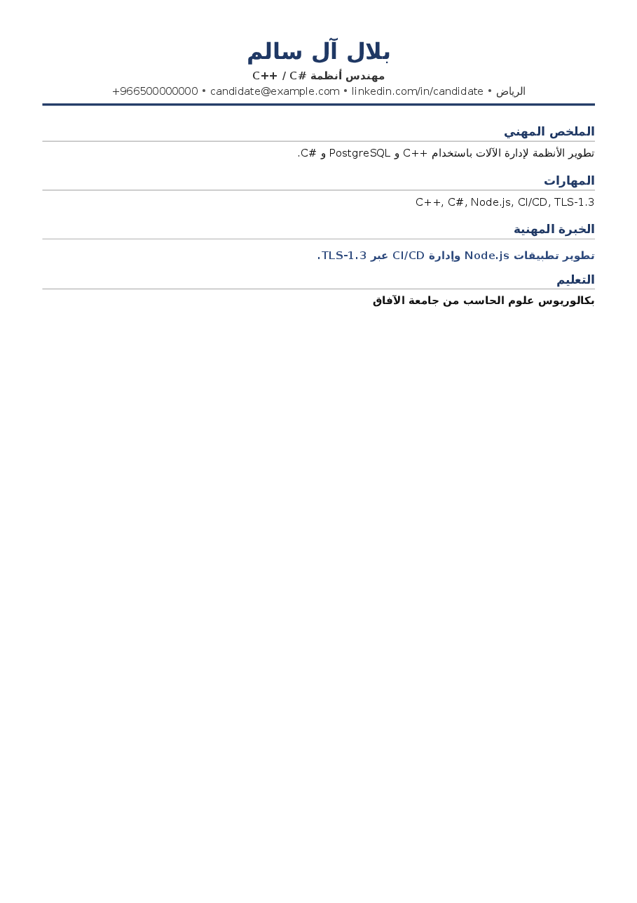

# Arabic PDF text boundary verification

The production chain is `GeneratedCvController::downloadPdfApi` →
`CvTemplateRenderer::downloadResponse` → `LogicalTextMpdf`. Uploaded PDFs enter
through `CvTextExtractor::extractPdf`, which canonicalizes extracted Unicode
once. Database fields and the CV document remain logical and unchanged.

The baseline failures had two causes:

- `ArabicPdfText` expanded lam-alef glyphs before reversing their characters.
  For example, the visual glyph stream `ﻻ تﻻﻵا ةرادﻹ ﺔﻤﻈﻧﻷا` became
  `األنظمة إلدارة اآلالت ال` instead of `الأنظمة لإدارة الآلات لا`.
- Structured sections bypassed the Markdown renderer's Latin embeddings, so
  neutral symbols in `C++` and `C#` followed the RTL paragraph direction.
  Protecting only Markdown and candidate identity fields missed the exported
  summary, experience, and skills. FreeSans GSUB also introduced Latin `ff`/`ffi`
  ligatures that changed extracted English facts.
- A Latin embedding that included terminal `.`, `-`, or `/` moved sentence
  punctuation between the Latin identifier and the preceding Arabic. Logical
  `ActualText` still looked correct, so extraction-only tests missed the render.

Export now protects all rendered HTML body text nodes. Internal punctuation is
kept with Latin identifiers when followed by letters/digits; suffix `+` and `#`
remain attached, while sentence punctuation follows the RTL paragraph. Arabic
shaping remains enabled; Latin GSUB substitutions are disabled. Hyphenation is
disabled so technical identifiers are moved intact to the next line instead of
being split at internal hyphens, which parsers turn into inserted spaces.
The mPDF adapter captures each
line before bidi reordering and writes standard PDF `ActualText` in logical
Unicode alongside the existing glyph commands. Empty inline objects (including
list markers) cannot consume the line's replacement text. Each marked sequence
stays on its page, including wrapped paragraphs and table/layout replays.

`normalizeExtracted` no longer reverses text or guesses its direction from
Arabic spelling. It unshapes presentation forms and removes explicit display
controls idempotently. The retained direction argument is backward compatible
at the call boundary; direction is now represented by the PDF renderer.
Untagged third-party visual PDFs need an explicit source-specific adapter.

Acceptance coverage uses the actual download bytes: 617 Arabic/Latin lines
compare exactly with their source runs across multiple pages. Seed `46098`
shuffles all 37 standard Arabic letters/hamza variants/wasla (plus an empty
prefix) before each of the four lam-alef combinations, covering both joining
and non-joining predecessors, including `ة ى ء ؤ ئ`. Latin roots, multi-word
runs, digits, and punctuation sequences are generated independently, rather
than a fixed root or suffix list. Every failure prints the seed and run index.
A 640-run paragraph (seed `46100`) additionally checks wrapping and page order.
An English-only export (seed `461019`) compares 58 complete lines exactly,
including generated words around `ff/fi/fl/ffi/ffl/ft/st` and `office affinity`.
The download
is also uploaded through the production extractor, and stored attributes must
remain byte-for-byte unchanged. JobMatch export expectations are unchanged.

The adapter uses mPDF 8.x private service integration because that version has
no ActualText extension hook. The dependency retains Composer's `^8.3` range
rather than an exact pin. Constructor preflight verifies `writer`, `fontCache`,
and `otl` before engine initialization; a missing, static, or typed service
throws a clear integration error with the installed mPDF version and affected
property. Tests remove each service in turn and exercise incompatible property
shapes. Real export tests also guard this dependency on upgrade.

Visual check: Ghostscript `png16m`, 110 dpi, text/graphics antialiasing 4, first
page of `storage/app/testing/arabic-pdf-logical.pdf` produced by
`CvPdfRenderingTest::test_mixed_arabic_fields_export_logically_with_symbols_and_lam_alef`.
The raster was opened and inspected: joined Arabic, lam-alef, RTL alignment,
contact order, and intact `C++`, `C#`, `PostgreSQL`, `Node.js`, `CI/CD`, and
`TLS-1.3` throughout header and structured sections. The regenerated summary's
full stop is to the left of `C#`, and the experience line's full stop is to the
left of `TLS-1.3`. The previous raster inspection missed that punctuation defect.
Seed `461018` now tests 66 generated sentences ending in Latin identifiers and
URLs with and without `++`/`#`, across 11 punctuation marks. It asserts the mark occupies
the left end of the actual PDF glyph-showing commands, independently of logical
`ActualText`; the test failed against the previous renderer.

The [PDF used for this raster](arabic-pdf-logical.pdf) is retained for review.

Validation commands: `php vendor/bin/phpunit --filter=JobMatch` plus the Arabic
text, Markdown, PDF rendering, ATS parse-back/scoring/calibration, template, and
export-safety test files. Session-backed admin tests use a temporary process-only
APP_KEY. No full-suite run is performed.

Latest results: all 318 JobMatch tests passed (5,332 assertions), and all 61
related tests passed (1,408 assertions). Pint and `git diff --check` passed.
The temporary bootstrap was removed after verification; application configuration
and stored CV data were not changed.
